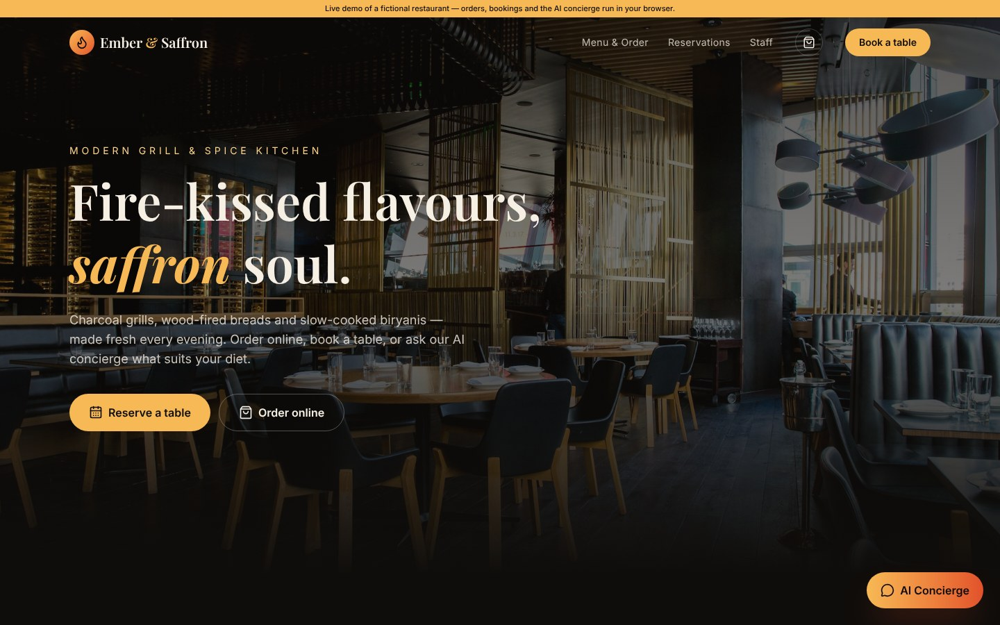
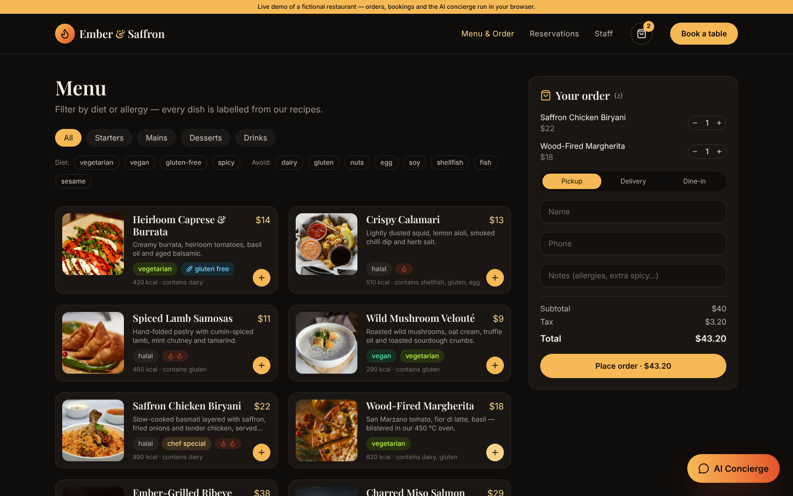
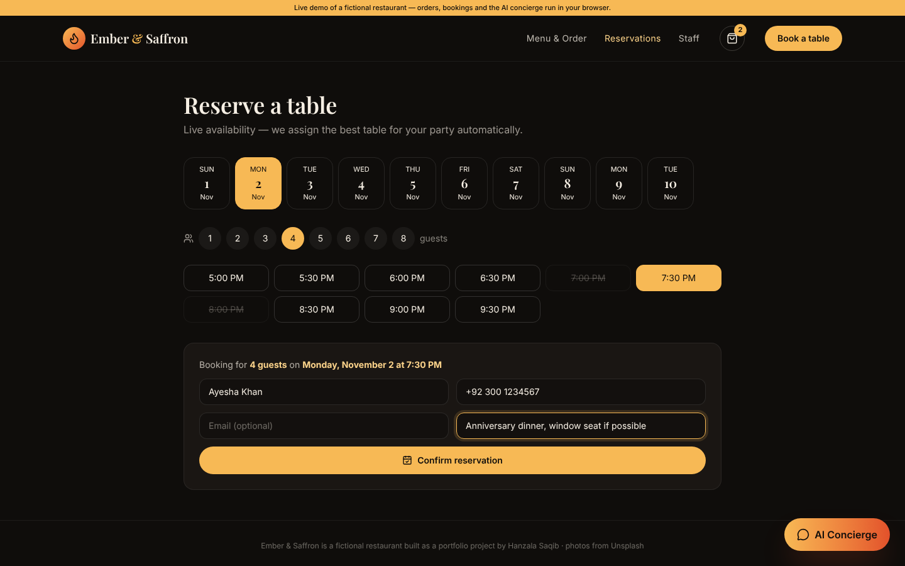
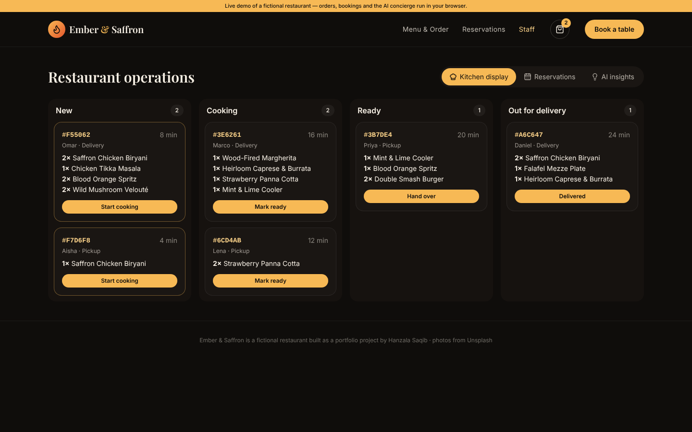
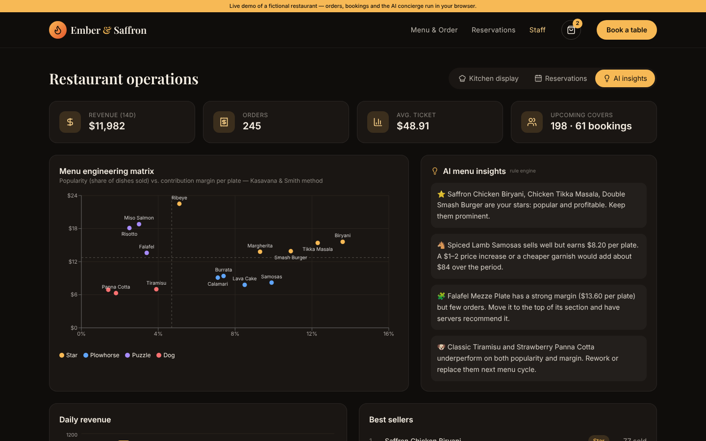
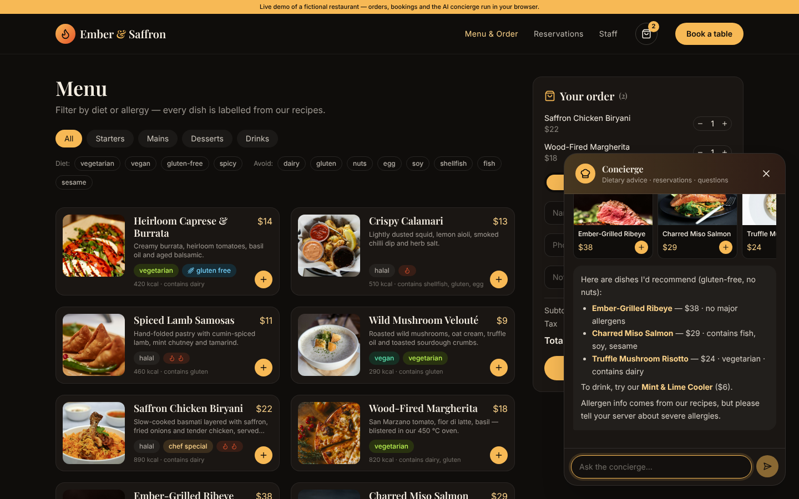
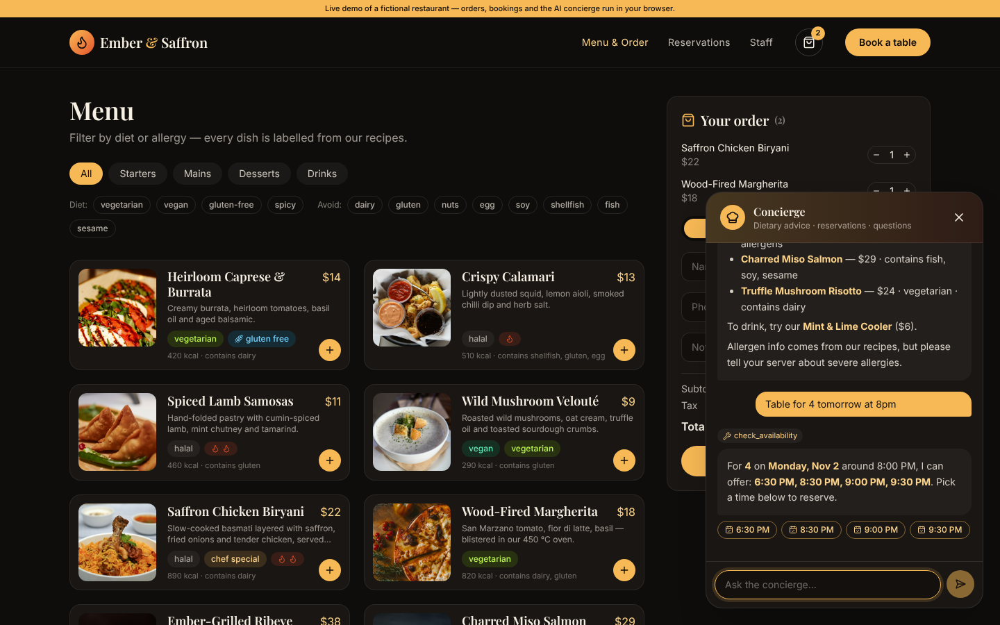
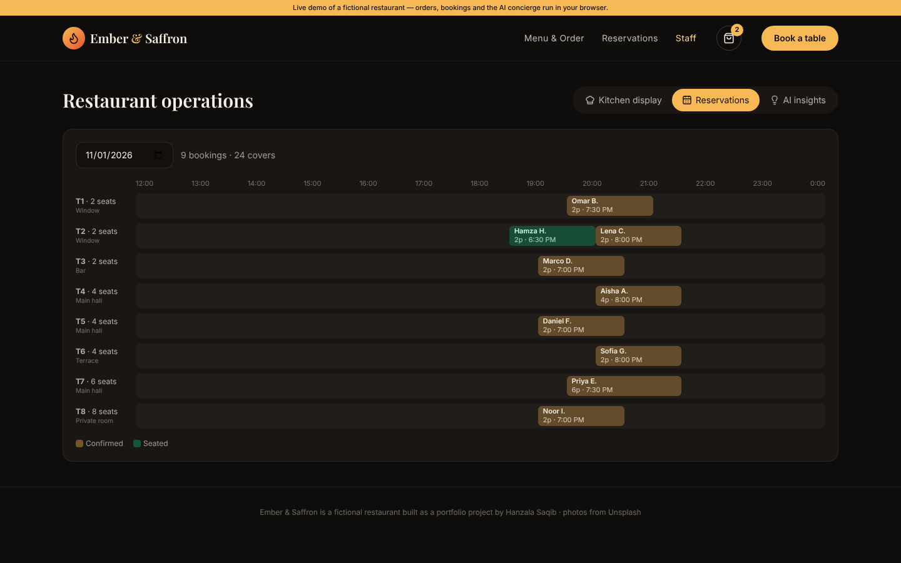
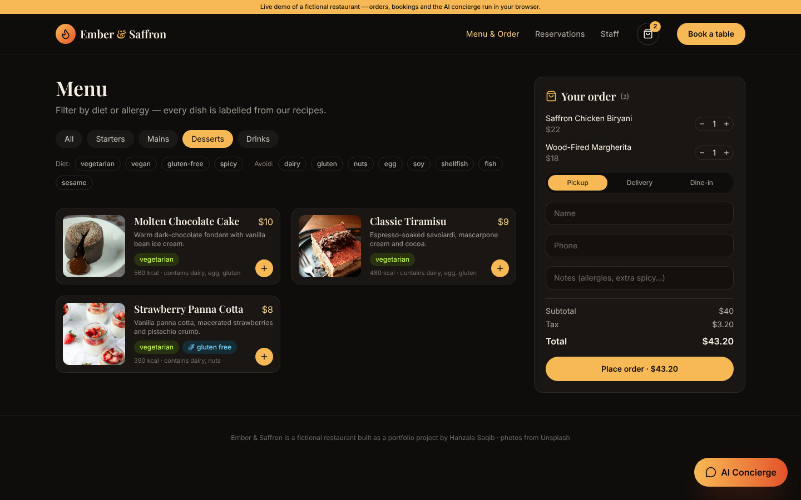
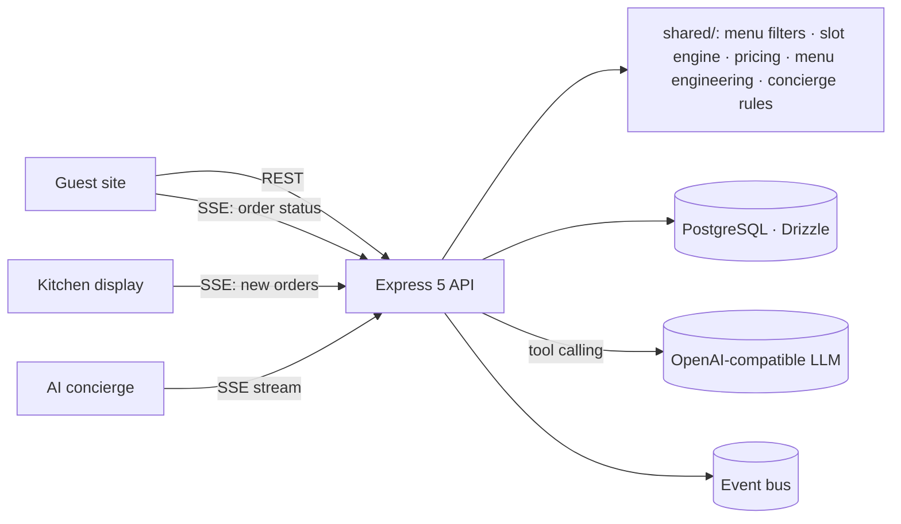

<div align="center">

# 🔥 Ember & Saffron — AI Restaurant Platform

### A full-stack restaurant website with online ordering, live table reservations, a kitchen display and an AI concierge

Guests browse an allergen-labelled menu, order for pickup or delivery and track the order live. They can book a table (it's assigned automatically) or ask the **AI concierge** for dishes that fit their diet. Staff get a **real-time kitchen display**, a **reservation timeline** and **AI menu-engineering insights**.

[](https://hanzalasqb.github.io/ember-saffron-restaurant/)




</div>

---

## ✨ Features

### Guests
- 🍽️ **Smart menu**: every dish is tagged for diets (vegan, vegetarian, gluten-free, halal) and allergens (dairy, gluten, nuts, egg, soy, shellfish, fish, sesame), with filters such as *"vegan, no sesame"*
- 🛵 **Online ordering**: pickup, delivery or dine-in. Server-side totals (tax, delivery fee and free-delivery threshold) and **live order tracking** over Server-Sent Events
- 📅 **Table reservations**: live availability in 30-minute slots with **best-fit table assignment** (smallest table that fits). Dining time depends on party size, and a Postgres advisory lock in a transaction prevents double-booking
- 🤖 **AI concierge**: recommends dishes for allergies and diets, checks availability and books tables. It uses LLM tool calling (`search_menu`, `check_availability`, `create_reservation`, `get_restaurant_info`) with a rule-based NLP fallback

### Staff
- 👨‍🍳 **Kitchen display system**: live Kanban (New → Cooking → Ready → Out for delivery) that shows new orders the moment they're placed
- 🗓️ **Reservation timeline**: tables × hours board with confirmed and seated bookings
- 📈 **AI menu engineering**: the classic Kasavana & Smith matrix (popularity vs. contribution margin) sorts dishes into *Stars, Plowhorses, Puzzles and Dogs*, with concrete pricing and placement recommendations (LLM or rule engine)

## 📸 Screenshots

| Allergen-aware menu & ordering | Live table reservations |
|---|---|
|  |  |
| **Real-time kitchen display** | **AI menu-engineering insights** |
|  |  |
| **AI concierge: allergy-aware suggestions** | **AI concierge: checks live table availability** |
|  |  |
| **Reservation timeline for staff** | **Desserts with dietary labels** |
|  |  |

## 🏗️ Architecture



## 🛠️ Tech stack

| Layer | Technologies |
|---|---|
| **Frontend** | React 19, TypeScript, Vite, Tailwind CSS v4, Recharts, EventSource (SSE) |
| **Backend** | Node.js 22, Express 5, TypeScript, Zod, jose (JWT), bcryptjs, Helmet, rate limiting |
| **Database** | PostgreSQL 16 + Drizzle ORM migrations (PGlite for local dev/tests) |
| **AI** | OpenAI-compatible streaming function calling, NLP dietary/allergen parser, booking-intent parser |
| **Quality** | Vitest + Supertest (ordering, double-booking prevention, RBAC, analytics, LLM tool loop) |
| **DevOps** | Docker Compose, Nginx (SSE-aware proxy), GitHub Actions CI + Pages demo |

## 🚀 Getting started

```bash
git clone https://github.com/hanzalasqb/ember-saffron-restaurant.git
cd ember-saffron-restaurant
cp server/.env.example server/.env        # JWT_SECRET, ADMIN_PASSWORD, optional LLM_API_KEY, TZ
docker compose up --build                 # site http://localhost:3000 · API http://localhost:4100
```

Local development (embedded PGlite, no database to install):

```bash
cd server && npm install && cp .env.example .env && npm run dev
cd client && npm install && npm run dev   # http://localhost:5173
```

## 🔌 API

| Method | Endpoint | Description |
|---|---|---|
| `GET` | `/api/menu` · `/api/restaurant` | Menu with diet & allergen data, hours |
| `POST` | `/api/orders` · `GET /api/orders/:code/stream` | Place an order, then follow its status live (SSE) |
| `GET/POST` | `/api/availability` · `/api/reservations` | Slots and bookings with automatic table assignment |
| `POST` | `/api/concierge/stream` | AI concierge (SSE: `dishes`, `booking`, `reservation`, `token`) |
| `GET` | `/api/admin/kitchen/stream` | Kitchen display feed (staff JWT) |
| `GET` | `/api/admin/analytics` | KPIs, menu-engineering matrix, AI insights |

## 🧪 Tests

```bash
cd server && TZ=Asia/Karachi npm test
```

## 📄 Notes

Ember & Saffron is a fictional restaurant built as a portfolio project. Menu photos come from [Unsplash](https://unsplash.com) (Unsplash License). No real orders or payments are processed in the demo.

**Author:** Hanzala Saqib, Full Stack AI Developer · [GitHub](https://github.com/hanzalasqb) · [LinkedIn](https://www.linkedin.com/in/hanzalasqb) · MIT License
